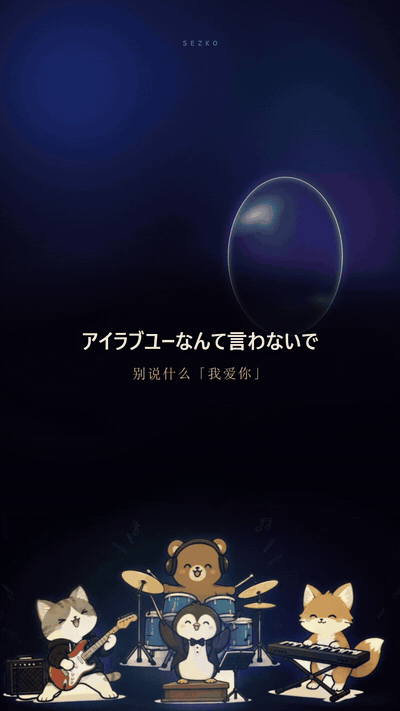
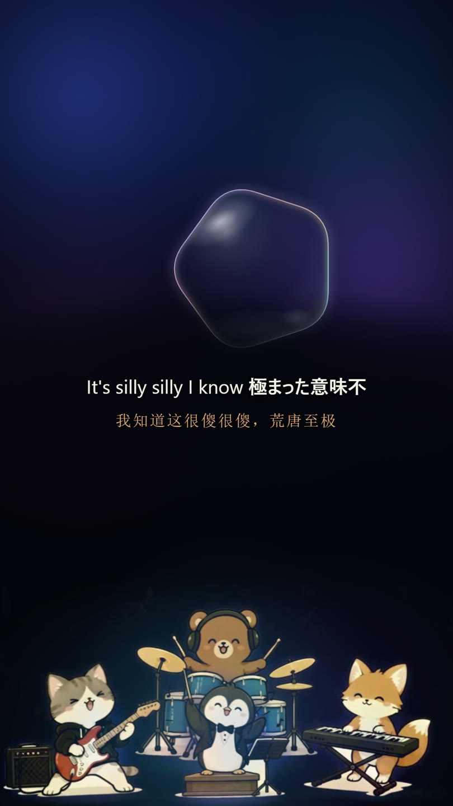
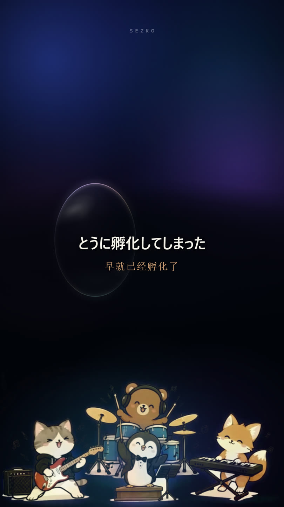
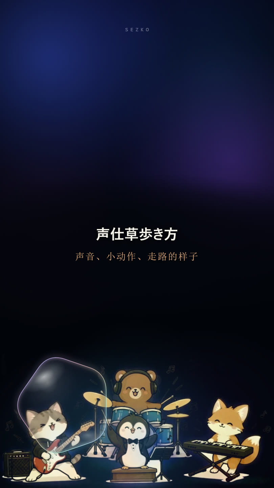
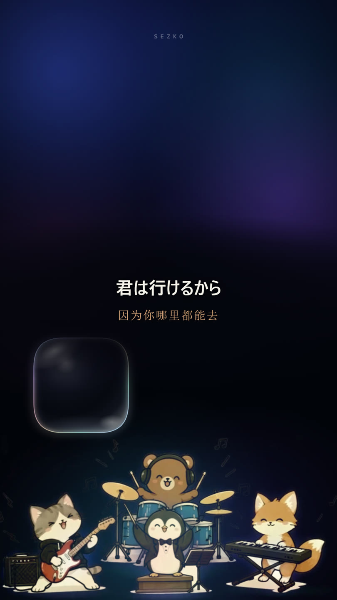
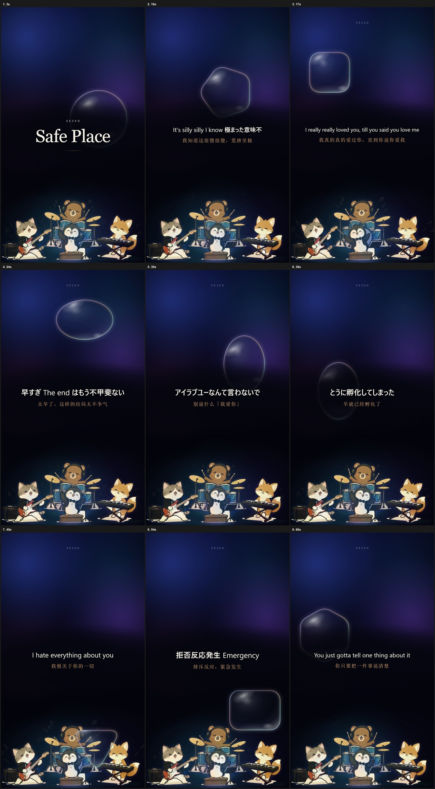
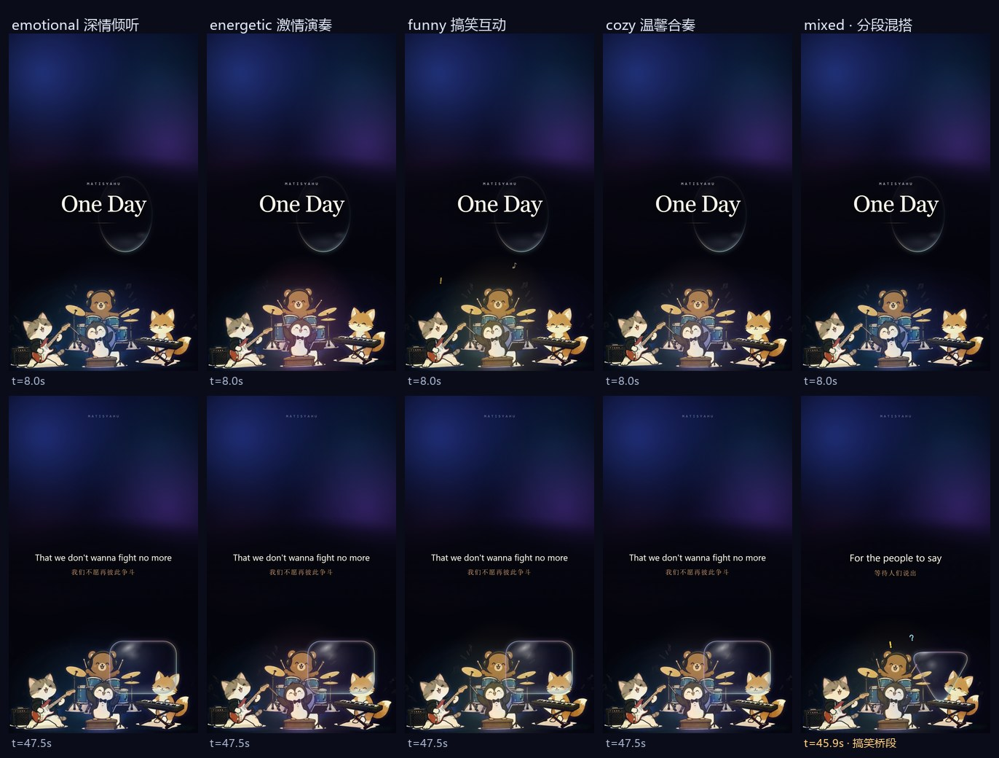

# lyric-video

> 给一首歌，自动生成一条 1080×1920 竖屏双语歌词视频。
> **只需要两样东西：MP3 音频 + 歌手名。** 有官方歌词更好（文本零猜测），没有也能用 Whisper 自动重建。

## ✨ 效果展示

以 SEZKO《Safe Place》（英日混唱）为例 —— 全部画面由本 skill 流水线自动生成：

<p align="center">
  
</p>
<p align="center"><em>玻璃体漂移撞边变形 · 双语字幕逐句切换 · 底部小动物乐队循环</em></p>

<table>
  <tr>
    <td align="center"><br><em>英日混排行：原文 + 中文两行</em></td>
    <td align="center"><br><em>日语副歌，玻璃体撞边压缩</em></td>
  </tr>
  <tr>
    <td align="center"><br><em>纯日语行，假名正常出字</em></td>
    <td align="center"><br><em>片尾卡 + 常驻乐队</em></td>
  </tr>
</table>

<p align="center">
  
</p>
<p align="center"><em>16 个时间点抽帧（混排 / 日语 / 副歌 / 片尾全覆盖）</em></p>

## 🎸 乐队表演风格（同一首歌，五种演法）

底部小动物乐队不再只有一种循环演法：默认 `classic` 完整保留本站最初的观感（向后兼容，旧项目零改动），
另外提供 **深情倾听 / 激情演奏 / 搞笑互动 / 温馨合奏** 四种风格，以及按乐句能量自动分段的 `mixed` 混搭模式。

<p align="center">
  
</p>
<p align="center"><em>同曲同时间点 A/B：上排 t=8s（姿态来自播放速率差异），下排 t=47.5s 同一句歌词；
最右列为 mixed，搞笑桥段带定格 + 反应气泡</em></p>

| 风格 | 适合 | 动画强度 | 互动概率 |
| --- | --- | --- | --- |
| `classic` 经典循环 | 任何歌（默认 / 兜底） | 0.00 | 0.00 |
| `emotional_listening` 深情倾听 | 慢歌、低能量、抒情 | 0.25 | 0.05 |
| `energetic_performance` 激情演奏 | ≥105 BPM、高能量 | 1.00 | 0.15 |
| `funny_interaction` 搞笑互动 | 过门、hard stop、rolls 多 | 0.70 | 1.00 |
| `cozy_ensemble` 温馨合奏 | 中速平稳、陪伴感 | 0.45 | 0.35 |

风格选择优先级：**`--style` 命令行 > `project.json.style` > `auto` 自动推荐 > `mixed` 分段**。
所有差异都是参数化的：播放速率（0.625×/1.0×/1.25×，均与 30 fps 输出整数对齐）、编舞曲线（摇摆/弹跳/呼吸/拍点冲击）、
角色锚点 SVG 点缀（音符/爱心/闪光/!/?）、定格 + 反应气泡的搞笑桥段、风格化舞台光。
随机行为全部由 `crc32(歌手|歌名)` 种子预生成时间表，渲染状态是 `t` 的纯函数——同时间点两次渲染像素级一致，
**风格切换绝不动歌词时间轴**。参数与 auto 判定链锁定值见 `references/style-spec.md`。

## 🎯 特性

- **固定视觉规范**，不逐首重新设计：深蓝紫梦境背景 + 两组光斑交叉淡入 + 单个透明玻璃几何体（8 种圆角轮廓，撞屏幕边缘沿法线压缩 11% 后变形反弹）+ 底部小动物乐队（猫/熊/企鹅/狐狸）无缝循环。
- **居中双语字幕**：原文在上（Inter，含 Yu Gothic/Meiryo 假名兜底），中文在下（宋体，暖棕 `#DDA97D`），整块以 y≈960 为光学中心，同组淡入淡出；画面里没有任何 VERSE / CHORUS 段落标签。
- **时间轴全部实测**：字幕起止来自 Whisper 词级时间戳，禁止用 BPM/节拍网格推算；成片时长严格等于音频时长（±1 帧内）。
- **五种乐队演法 + 分段混搭**：`classic`（默认，保留最初观感）/ `emotional_listening` / `energetic_performance` / `funny_interaction` / `cozy_ensemble`，可按乐句能量自动分段切换；手动指定风格永远优先。
- **语言支持 en / ja / zh**：英文、日文（假名字体兜底）、中文原文歌（不显示空译行）均已实测；混唱按逐句实际语言走原文 + 中文两行。
- **混语言歌支持**：逐窗自动判语种（英语+日语、英语+韩语等均可），另一种语言不会被强行听写成第一种。
- **完全可复现**：玻璃体运动种子由「歌手名+歌名」决定，同一首歌每次重跑视觉路径完全一致；改歌词不用重做视觉。

## 📥 输入

| 输入 | 必需性 | 说明 |
| --- | --- | --- |
| 音频文件 | **必需** | 任意 MP3/WAV/FLAC，时长不限 |
| 歌手名 | **必需** | 用于片头、常驻角标、片尾署名 |
| 官方歌词 | 可选 | 给了走快路径（文本零猜测）；不给则 Whisper 重建 + 多通道交叉验证 |
| 歌名 / 主题句 | 可选 | 缺省取文件名；主题句为片头标题下一行中文 |
| 乐队风格 | 可选 | `auto` / `mixed` / 五种风格之一，缺省 `auto`；手动指定永远优先 |

## 🛤 歌词的两种路径

**3A · 官方歌词快路径（首选）** —— 用户提供了官方歌词时：

- 文本一行不改直接采用，时间轴用官方歌词作 `initial_prompt` 分区重解拿词级时间戳
- 全曲切 20–26 s 窗口逐窗解，混语言歌每窗英/日双路各解一遍互相验证，抢拍句加 2 s 窄窗补锁
- 官方歌词与复解听感不一致 → 按官方采用，差异列进 NOTES.md 请用户确认
- 一口气唱完、拆开不足 1 秒的两行 → 合并为一行显示（文字不改，仅并排）

**3B · Whisper 重建路径** —— 没有官方歌词时：

- 全曲转写（混语言歌走逐窗判语种）→ 校对拼写 → 逐句翻译 → 词匹配对齐
- 对不上的段落用提示词重解补实测时间戳，直到每一行都锚定到真实唱出的时间

> 提示词质量直接决定复解精度：**官方歌词 > 猜的歌词 > 无提示词**。

## 🔧 流水线

```bash
# 1. 建项目：建目录 → 复制音频 → 转 16k WAV → 节拍分析 → 注入模板素材
python scripts/new_project.py "<音频路径>" "<歌手名>" [--title "歌名"] [--style auto]

# 2. 转写（混语言歌用 transcribe_mixed.py；3A 路径此步可选）
python scripts/transcribe.py "<project>" --model medium.en --lang en
python scripts/transcribe_mixed.py "<project>" --model large-v3-turbo

# 3. 写歌词源（人工步）：lyrics_source.json，逐行 en/zh + 显式 start/end
# 3.5 对不上的段落：提示词重解拿实测词级时间
python scripts/rescan.py "<project>" --from 6.0 --to 20.0 --model large-v3-turbo --lang en --prompt "<该段歌词>"

# 4. 对齐 + 生成（align 输出「every line anchored to a real sung timestamp」才继续）
python scripts/align_lyrics.py "<project>" && python scripts/motion.py "<project>"
python scripts/plan_styles.py "<project>"          # 风格规划 → style_plan.json（可 --style 覆盖）
python scripts/gen_storyboard.py "<project>" && python scripts/build_frame.py "<project>"
python scripts/make_index.py "<project>"

# 5. 校验：lint/runtime/layout/motion 0 error，contrast 过 WCAG AA，抽帧实看
hyperframes check . && hyperframes snapshot . --at "3,20,60,120" --no-end -o build/shots

# 6. 渲染 + 验收
hyperframes render . --skill=music-to-video -q delivery -o renders/video.mp4 --fps 30
python scripts/verify.py "<project>"
```

## 🚀 使用方式

**作为 WorkBuddy skill**：本仓库即 skill 包，克隆到 `~/.workbuddy-ai/skills/lyric-video` 后，对话里给出音频路径和歌手名即可触发（官方歌词随附即可，不给就自动重建）。

**独立使用**：按上面的流水线手动执行；`scripts/` 内每个脚本都可单独运行，`references/style-spec.md` 记录了全部视觉细节参数（颜色、字号、动画曲线、坑位）。

## 📦 环境依赖

- [HyperFrames](https://hyperframes.dev) CLI（渲染引擎，含 `music-to-video` skill 的节拍分析脚本）
- Python：`faster-whisper`、`librosa`、`soundfile`、`numpy`、`scipy`、`pillow`
- Whisper 模型：`large-v3-turbo`（提示词重解首选）、`medium.en`（英语全曲转写）等，本地目录或自动下载
- ffmpeg / ffprobe 在 PATH

## 📁 目录结构

```
lyric-video/
├── SKILL.md                    # skill 入口：完整流程与纪律
├── scripts/                    # 11 个流水线脚本
│   ├── new_project.py          #   建项目 + 节拍分析（--style 写入 project.json）
│   ├── transcribe.py           #   全曲转写
│   ├── transcribe_mixed.py     #   混语言歌逐窗判语种转写
│   ├── rescan.py               #   提示词分区重解（时间轴精度核心）
│   ├── align_lyrics.py         #   歌词-音频对齐（manual 通道）
│   ├── motion.py               #   玻璃体运动（种子可复现）
│   ├── plan_styles.py          #   乐队风格规划（auto/mixed/固定）→ style_plan.json
│   ├── gen_storyboard.py       #   分镜
│   ├── build_frame.py          #   帧模板渲染（注入风格 payload）
│   ├── make_index.py           #   合成索引
│   └── verify.py               #   成片规格验收
├── assets/                     # 帧模板 + 乐队雪碧图 + GSAP
├── config/                     # 风格参数（styles.json）+ 角色卡（characters.json）
├── references/style-spec.md    # 视觉规范细节（含风格系统锁定值）
└── docs/images/                # README 展示素材
```
